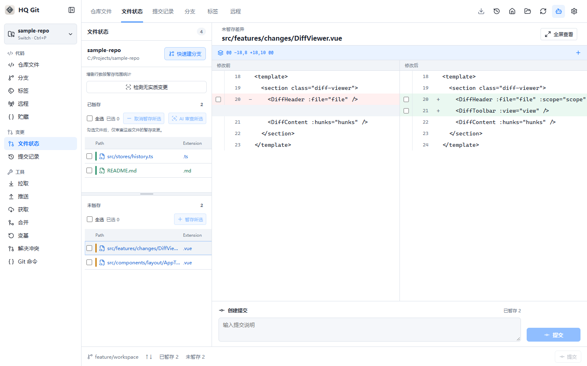
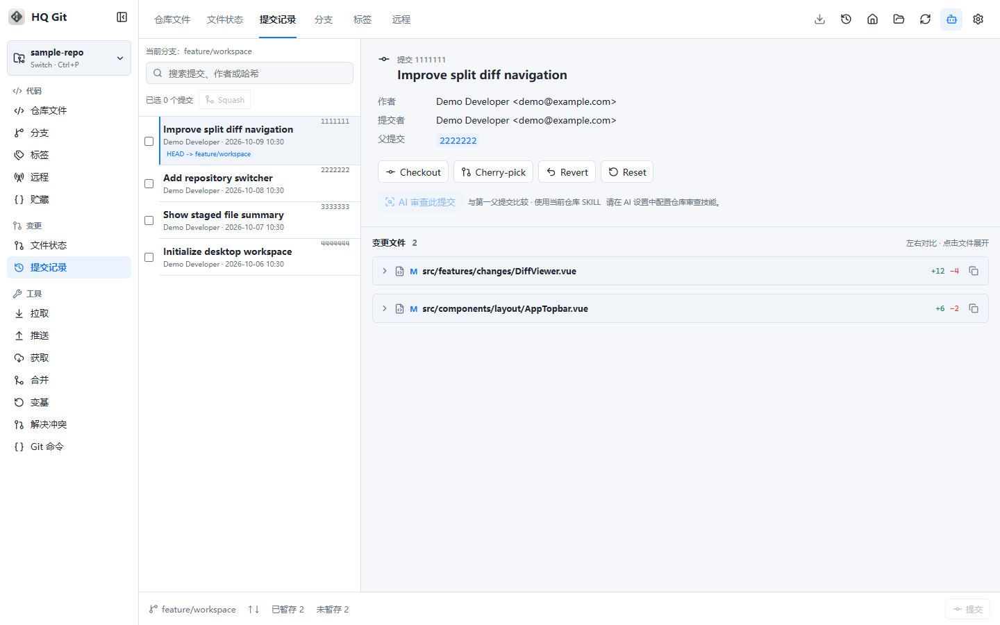

# HQ Git

HQ Git 是一款面向 Windows 的 Git 桌面客户端，基于 Tauri 2、Vue 3 和 Rust 构建。它将仓库文件、工作区变更、分支、历史、远端与终端集中在同一个界面，并提供可选的 AI 辅助功能。

## 界面预览

变更与差异：



提交历史：



截图使用演示数据。

## 下载与使用

前往 [GitHub Releases](https://github.com/xz-he/x-git/releases/latest) 下载最新的 Windows x64 安装包（`*-setup.exe`）。安装后可打开本地仓库、克隆远端仓库，或在选定目录初始化新仓库。应用调用本机的 Git，请先安装 [Git for Windows](https://git-scm.com/download/win)，并确保 `git` 可在命令行中运行。

正式安装版可在应用内的“设置 → 版本更新”检查新版本。更新需要用户确认，不会自动安装。

## 主要功能

- 管理多个仓库，快速切换最近使用的仓库；浏览和编辑仓库文件。
- 查看工作区变更与差异，暂存文件或部分改动、提交，并浏览提交历史。
- 管理分支、标签、远端和暂存区（stash）；执行 fetch、pull、push、merge 与 rebase。
- 查看和解决合并冲突，在应用内使用 Git 命令控制台与交互式终端。
- 按需配置 AI 服务，用于对话、代码审查、提交信息和冲突解决建议。AI 功能需要自行提供服务地址、模型和 API Key；当前设置为兼容旧版本，会在本机以明文保存 API Key。
- 切换界面语言、主题和字体，并检查应用更新。

## 本地开发

开发环境需要 Windows、Git、与 Vite 8 兼容的 Node.js 和 npm、Rust 工具链，以及 Tauri 在 Windows 上所需的 WebView2 与 C++ 构建工具。安装依赖后启动桌面应用：

```powershell
npm ci
npm run tauri -- dev
```

常用命令：

| 命令 | 用途 |
| --- | --- |
| `npm run dev` | 仅启动 Vite 前端开发服务器 |
| `npm run tauri -- dev` | 启动完整桌面应用 |
| `npm run build` | 检查 TypeScript 并构建前端 |
| `npm test` | 运行 Vitest 测试 |
| `npm run release:version -- --check` | 检查各处版本号是否一致 |

`npm run dev` 仅运行前端；仓库操作依赖 Tauri 后端，需要通过桌面应用验证。

## 项目结构

| 路径 | 内容 |
| --- | --- |
| `src/` | Vue 界面、状态管理及前端测试 |
| `src-tauri/` | Rust 后端、Tauri 配置和 Windows 打包资源 |
| `public/` | 前端静态资源 |
| `scripts/` | 版本管理与打包脚本 |

Windows 安装包的签名构建和 GitHub Release 流程见 [RELEASE.md](RELEASE.md)。构建正式安装包需要更新签名私钥；不要将私钥提交到仓库。
